# Antitrust RAG

Question answering over public competition-law texts, with answers that cite the exact provision
they rely on — e.g. `[Lei 12.529/2011, Art. 36, §3]` or `[TFEU, Art. 102]` — and that say
**"Not found in sources."** instead of guessing.

Corpus: Brazil's competition law (**Lei nº 12.529/2011**) and **Articles 101 and 102 TFEU** (EU).
Questions can be asked in English or Portuguese; a multilingual embedding model puts both
languages in the same vector space.

> Portfolio project by Guilherme Faria Vaz. Legal information, not legal advice.

**Stack:** Python 3.11+ · FastAPI · PostgreSQL + pgvector (HNSW) · Postgres full-text search ·
sentence-transformers (`intfloat/multilingual-e5-small`) · optional cross-encoder reranker ·
Anthropic Claude (official `anthropic` SDK) · pytest · ruff · mypy · Docker · GitHub Actions.

---

## What it does

| Endpoint | Purpose |
|---|---|
| `GET /health` | Store reachability, chunks indexed, whether Claude is configured, counters (asks, LLM calls, tokens, estimated cost, cache hits). |
| `POST /ingest` | Index the bundled offline sample (`origin: "sample"`) or download the official texts (`origin: "remote"`). Re-ingesting a source replaces it. |
| `POST /search` | Retrieval only: `hybrid` (default), `lexical` or `vector`, optional source filter and reranking. Returns chunks with citations, per-retriever ranks and timings. |
| `POST /ask` | Retrieval + Claude. Returns the answer, whether it is grounded, each citation checked against the sources sent, token usage, estimated cost, cache flag and timings. |

OpenAPI docs are served at `/docs`.

## Architecture

```mermaid
flowchart LR
    subgraph Ingestion
        A[Planalto / Câmara<br/>Lei 12.529/2011] --> F[fetch + HTML to lines<br/>retries, fallback URL]
        B[EU Publications Office<br/>TFEU 101, 102] --> F
        S[data/sample<br/>offline excerpts] --> P
        F --> P[structure-aware parser<br/>Art. > § > inciso > alínea]
        P --> C[chunker<br/>article / paragraph / item groups<br/>+ context header]
        C --> E[embedder<br/>multilingual-e5-small or fake]
    end
    E --> DB[(PostgreSQL + pgvector<br/>HNSW on embedding<br/>GIN on tsvector)]
    Q[question] --> L[lexical search<br/>tsvector, OR query]
    Q --> V[vector search<br/>cosine, HNSW]
    DB --- L
    DB --- V
    L --> R[Reciprocal Rank Fusion]
    V --> R
    R --> X{rerank?}
    X -- yes --> CE[cross-encoder]
    X -- no --> K[top-k chunks]
    CE --> K
    K --> G[prompt builder<br/>numbered sources + citation tags<br/>context budget]
    G --> CL[Claude<br/>timeout, retries, backoff]
    CL --> V2[citation check<br/>+ tokens, latency, cost]
    V2 --> API[FastAPI /ask<br/>TTL cache, JSON logs]
```



Code map (`src/antitrust_rag/`):

| Module | Responsibility |
|---|---|
| `sources.py` | Source registry, download with retries and fallback URLs, HTML to text lines, offline sample I/O |
| `chunking.py` | Parsers for Brazilian statutes and EU treaty articles; structure-aware chunker |
| `embeddings.py` | `Embedder` protocol, local sentence-transformers embedder, deterministic `FakeEmbedder` |
| `store/postgres.py` | pgvector + tsvector schema, upsert, vector and lexical search |
| `store/memory.py` | In-memory store (numpy cosine + Okapi BM25) with the same interface, for tests and the offline demo |
| `retrieval.py` | Hybrid retriever, Reciprocal Rank Fusion, optional cross-encoder reranker |
| `generation.py` | System prompt, context budget, Claude client (timeouts, retries, backoff), cost estimate, citation check |
| `service.py` | Wires everything together; cache; counters |
| `api.py` | FastAPI app, Pydantic models, request logging with request ids |
| `evaluation.py`, `cli.py` | recall@k / MRR and the `ingest` / `evaluate` command-line tools |

## Design decisions and trade-offs

**Chunking follows the law's structure, not a token window.** Lawyers cite "Art. 36, §3, I", so
that is the unit we store. A short article is one chunk. A long one is split at its paragraphs
(caput, §1, §2 ...); a paragraph that is still long (Art. 36 §3 lists 19 conducts) is split into
groups of consecutive incisos, and each group repeats the paragraph's opening sentence. Every chunk
starts with a context header (law, title/chapter, locator) and, for paragraph chunks, the start of
the article's caput, because a bare "§ 2º Presume-se..." says nothing about which article it
belongs to. Amendment notes such as "(Incluído pela Lei ...)" and vetoed or revoked provisions are
dropped. Trade-off: chunk sizes vary (about 180 to 1,350 characters, median about 560, on the full law) and the parser is tuned to
the layout of these two publishers; another source would need its own parser.

**Hybrid retrieval fused with Reciprocal Rank Fusion.** Lexical scores and cosine similarities sit
on unrelated scales, so adding them needs per-query normalization. RRF (`Σ 1/(k + rank)`, k = 60)
uses only ranks, has a single parameter and is cheap. Lexical search catches exact terms
("leniência", "20%", "Article 102"); dense search catches paraphrases and questions asked in
another language.

**Lexical search: real BM25 in memory, `ts_rank_cd` in Postgres.** Postgres full-text search has
no BM25. The pgvector store uses a stored `tsvector` (`simple` config over accent-stripped,
lowercased text, GIN index) ranked by `ts_rank_cd`, which is a cover-density ranking without
corpus-wide IDF. The in-memory store implements Okapi BM25. Query terms are OR-ed, not AND-ed,
so a full question does not need every word to match. Native BM25 (e.g. ParadeDB `pg_search`) is
on the roadmap.

**The reranker is behind a flag because of latency.** On the eval below, the cross-encoder lifts
MRR from 0.52 to 0.77 on the full corpus, but on a 2-core CPU it adds about 3.5 s per query
(20 candidate pairs). Hybrid retrieval without it takes about 56 ms (p50; embedding the query is
about 35 ms of that). It is worth it on a GPU or with a smaller candidate pool, not by default on
a small CPU box.

**Cost and latency controls around Claude:**
- context budget (`RAG_MAX_CONTEXT_CHARS`, default 12,000) and `max_tokens` cap the cost of each request;
- no LLM call when retrieval returns nothing (cost zero, nothing to hallucinate from);
- TTL + LRU cache keyed on question, parameters, model and index version, so re-ingesting invalidates old answers;
- token usage and an estimated USD cost on every response and in `/health` (price table in `generation.py`, overridable by env var; an unknown model reports `null` rather than a guess);
- explicit timeout; retries with exponential backoff and jitter (honouring `Retry-After`) only on rate limits, connection errors and 5xx/overloaded; no retry on other 4xx;
- if Claude is down or no key is configured, `/ask` returns a clear 503 and `/search` keeps working.

**Grounding and citations.** The system prompt allows only the numbered sources, requires a
citation tag copied from the source on every sentence, and fixes the refusal string. After
generation every bracketed citation is parsed and checked against the (law, article) pairs that
were actually sent, and the result is returned as `supported: true/false`. This catches invented
articles; it does not prove that the sentence is a correct reading of the article.

**Two stores, one interface.** Postgres + pgvector is the real backend. The in-memory store lets
the whole test suite and the offline evaluation run with no database, no model download, no
network and no API key.

**Sources.** The ingest script tries the Planalto URL first and falls back to the Chamber of
Deputies' consolidated text when Planalto is unreachable or redirects to its portal (it does for
some non-Brazilian and datacenter IPs). EUR-Lex HTML pages sit behind a bot challenge (HTTP 202),
so the TFEU articles are fetched from the EU Publications Office (Cellar), which serves the same
EUR-Lex documents by CELEX number.

## Quickstart

### Option A: Docker (API + Postgres/pgvector)

```bash
cp .env.example .env            # add ANTHROPIC_API_KEY to enable /ask (optional)
docker compose up -d --build    # first start downloads the embedding model (a few hundred MB)
curl -X POST localhost:8000/ingest -H 'content-type: application/json' -d '{"origin":"remote"}'
open http://localhost:8000/docs
```

Use `{"origin":"sample"}` to index the bundled excerpt without downloading the laws.

### Option B: local Python

```bash
python -m venv .venv && source .venv/bin/activate
make install-ml                 # package + dev tools + sentence-transformers
docker compose up -d db         # or any Postgres with the pgvector extension
make ingest                     # download official texts and index them
make run                        # http://localhost:8000/docs
```

### Tests and evaluation (fully offline)

```bash
make install                    # no ML dependencies needed for the tests
make lint test                  # ruff + offline tests: fake embedder, mocked Claude, no key, no network
make test-pg                    # pgvector integration test (needs the compose db)
make eval-offline               # retrieval eval with the fake embedder
make eval                       # retrieval eval with the real local model + reranker
```

## Example

`POST /search` against the full law, hybrid mode, local model (real output, text trimmed):

```bash
curl -s -X POST localhost:8000/search -H 'content-type: application/json' \
  -d '{"query":"Which conducts are considered bid rigging in public tenders under Brazilian law?","top_k":2}'
```

```json
{
  "query": "Which conducts are considered bid rigging in public tenders under Brazilian law?",
  "mode": "hybrid",
  "results": [
    {
      "chunk_id": "f776f4623901fd49",
      "citation": "Lei 12.529/2011, Art. 36, §3, IV-VIII",
      "source_id": "lei-12529-2011",
      "url": "https://www2.camara.leg.br/legin/fed/lei/2011/lei-12529-30-novembro-2011-611850-normaatualizada-pl.html",
      "text": "[Lei 12.529/2011 | TÍTULO V - DAS INFRAÇÕES DA ORDEM ECONÔMICA > CAPÍTULO II - DAS INFRAÇÕES | Art. 36, §3, IV-VIII]\nCaput: Art. 36. Constituem infração da ordem econômica, ... …",
      "score": 0.016393,
      "ranks": { "vector": 1 }
    },
    {
      "chunk_id": "b7a9d07547f2da01",
      "citation": "Lei 12.529/2011, Art. 36, §3, I-III",
      "source_id": "lei-12529-2011",
      "text": "... I - acordar, combinar, manipular ou ajustar com concorrente ... d) preços, condições, vantagens ou abstenção em licitação pública; ...",
      "score": 0.016129,
      "ranks": { "vector": 2 }
    }
  ],
  "timings_ms": { "lexical_ms": 7.8, "embed_ms": 33.51, "vector_ms": 8.43 }
}
```

The lexical retriever found nothing here (an English question against Portuguese text), so
only the vector ranks appear. The provision that names public tenders (`§3, I, d`) came second;
the reranker is meant for cases like this.

`POST /ask` response shape (from the API schema; run it with your own key to see real answers):

```json
{
  "question": "Quando se presume posição dominante?",
  "answer": "… [Lei 12.529/2011, Art. 36, §2]",
  "grounded": true,
  "citations": [{ "citation": "Lei 12.529/2011, Art. 36, §2", "supported": true }],
  "sources": [{ "citation": "Lei 12.529/2011, Art. 36, §2", "score": 0.0, "...": "..." }],
  "usage": { "model": "claude-sonnet-5-5", "input_tokens": 0, "output_tokens": 0,
             "estimated_cost_usd": 0.0, "llm_attempts": 1 },
  "cached": false,
  "timings_ms": { "lexical_ms": 0.0, "embed_ms": 0.0, "vector_ms": 0.0, "llm_ms": 0.0, "total_ms": 0.0 }
}
```

## Evaluation

`eval/eval_set.jsonl` has 15 hand-written questions (11 English, 4 Portuguese), each labelled
with the article(s) that answer it. A retrieved chunk counts as relevant when its (law, article)
matches. Article-level labels keep the set valid when chunking changes; they are more lenient than
chunk-level labels. Metrics: **recall@k** (share of expected articles in the top k) and **MRR**
(1 / rank of the first relevant chunk).

These numbers come from runs on the machine where the project was built (2 CPU cores, no GPU).
The raw outputs are in `eval/results/`. Fifteen questions is a small set: read them as a sanity
check and a comparison between modes, not as a benchmark.

**1. Sample corpus (52 chunks), in-memory store, local `multilingual-e5-small`** (`make eval`):

| mode | recall@1 | recall@3 | recall@5 | MRR |
|---|---|---|---|---|
| lexical (BM25) | 0.467 | 0.533 | 0.600 | 0.506 |
| vector | 0.600 | 0.733 | 0.867 | 0.695 |
| hybrid (RRF) | 0.533 | 0.600 | 0.867 | 0.633 |
| hybrid + cross-encoder rerank | **0.800** | **0.867** | **0.933** | **0.839** |

**2. Full corpus (236 chunks: whole Lei 12.529/2011 + TFEU 101/102), PostgreSQL 18 + pgvector 0.8.6, same model:**

| mode | recall@1 | recall@3 | recall@5 | MRR |
|---|---|---|---|---|
| lexical (`ts_rank_cd`) | 0.267 | 0.400 | 0.400 | 0.322 |
| vector (HNSW) | 0.600 | 0.733 | 0.733 | 0.682 |
| hybrid (RRF) | 0.400 | 0.667 | 0.733 | 0.521 |
| hybrid + cross-encoder rerank | **0.733** | **0.800** | **0.867** | **0.769** |

**3. Sample corpus with the deterministic fake embedder** (`make eval-offline`; used in CI). It
only measures lexical overlap and is not a semantic model: lexical 0.506 MRR, "vector" 0.324,
hybrid 0.419.

What the numbers show:
- With plain RRF, hybrid does **worse** than vector-only at the top ranks. Most questions are in
  English and the law is in Portuguese, so the lexical list is mostly noise for them and RRF gives
  it equal weight. Fusion pays off on recall@5 and once the reranker reorders the fused pool.
- The cross-encoder is the largest single improvement, at about 3.5 s per query on CPU (see trade-offs).
- Next steps (roadmap): weighted RRF or language-aware fusion, translating the query into the
  corpus language for the lexical side, and a larger, chunk-level labelled eval set.

Answer quality (faithfulness of the generated text) is **not** evaluated yet: the eval covers
retrieval only, and Claude was not called while building this README.

## What has been verified

- Lint (ruff), type check (mypy) and the test suite (44 passed; the pgvector test is skipped without a database) pass in a clean virtualenv with only `.[dev]` installed, as in CI.
- The pgvector integration test passes against PostgreSQL 18.7 + pgvector 0.8.6.
- End to end on that database with the real `multilingual-e5-small` model: `POST /ingest {"origin":"remote"}` downloaded and indexed the full law (Câmara fallback; Planalto was unreachable from the build machine) and both TFEU articles; `/search` and `/health` worked; `/ask` without a key returned the documented 503.
- Claude calls are tested against mocks only, including one test that drives the real `anthropic` SDK over a mocked HTTP transport. No real Claude request was made, so no real answer, latency or cost figure appears here.
- The Dockerfile, `docker compose` and the GitHub Actions workflow were written for this setup but were not run on the build machine (no Docker available there). The CI steps were reproduced locally.

## Roadmap

- Run the Claude path end to end and add an answer-faithfulness eval (citation precision, refusal correctness on unanswerable questions).
- Weighted / language-aware fusion; native BM25 in Postgres (ParadeDB `pg_search`); Portuguese stemming.
- Prompt caching for the system prompt; streaming responses.
- Connection pooling (`psycopg_pool`), Redis for a cache shared across replicas, Prometheus metrics and tracing.
- More sources: CADE regulations and guides, EU Regulation 1/2003 and the EU Merger Regulation, with version dates so answers can say which wording they used.
- A small web UI that shows the cited provisions next to the answer.

## License

MIT, see [LICENSE](LICENSE). Legal texts in `data/sample/` are public; see `data/sample/README.md`.
